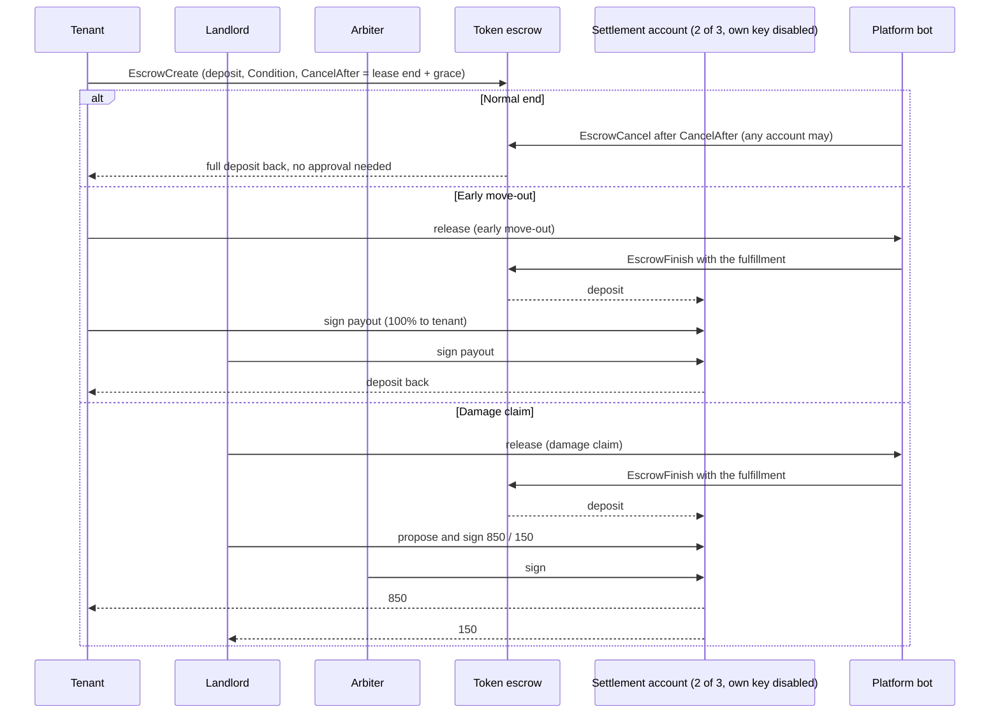

# Vindex

**Your deposit, returned by the ledger.** Vindex (repo: decelsus) protects rental security deposits with native
XRP Ledger features. The tenant locks the deposit in a token escrow. If the lease ends normally, the ledger hands it
back and nobody has to approve anything. If the tenant moves out early or the landlord claims damage, the deposit moves
to an account that only two of tenant, landlord and an independent arbiter can spend from together.
Vindex never holds the money and cannot move it. Built for IXH26 (Track 2, XRPL applications). Runs on the XRPL
Testnet with real Xaman accounts; not for mainnet.

## How it works



## XRPL features used

| Feature | Where |
|---|---|
| Token escrow (XLS-85) with an issued token | the deposit itself; `ledger/services.py` `create_escrow`, `finish_escrow`, `cancel_escrow` |
| Crypto-conditions (PREIMAGE-SHA-256) | early release needs a secret that stays on the server; `ledger/conditions.py` |
| Multisig: SignerList (quorum 2 of 3) with the master key disabled | the per-lease settlement account |
| Issued tokens and trust lines, `lsfAllowTrustLineLocking` | test EUR and USD |
| Memos | evidence photos: only the SHA-256 is anchored (`vindex/evidence`) |
| Batch | not used: the amendment is not enabled on Testnet (checked 2026-11-20). Payouts are sequential payments. |

## Architecture

Django 5.2 + xrpl-py on the server, server-rendered templates, vanilla JS ES modules in the browser, Xaman for every
signature (REST API in `ledger/xaman.py`, QR codes by `segno`). No build step, no frameworks, no CDNs.

```
config/        settings, urls
ledger/        client.py (network allow-list, refuses mainnet), services.py (every ledger operation), xaman.py (Xaman REST),
               conditions.py, errors.py
core/          models.py, agreements.py (draft, invites, arbiter approval), signing.py (Xaman sign requests),
               faucet.py (test funds), lifecycle.py (guarded state machine, bot), api.py (JSON API), views.py (page shells),
               middleware.py (CSP), context.py, management/commands/
templates/     base.html, partials/, escrow/ (home, dashboard, lease_create, lease_detail, invite, verify), legal/
static/js/     app.js (global), api.js, ui.js, poll.js, session.js, ledger.js (browser reads),
               actions.js, parts.js, splitform.js, dec.js, fx.js, sound.js, pages/
static/css/    global.css ("whitepaper" theme)
static/vendor/ xrpl.js (committed; browser ledger reads for the public verify page)
scripts/       setup.py (cross-platform setup), fetch_vendor.py
```

Pages are shells; each page's module renders from the JSON API. What an account may do comes only from the API's
`actions` list, and the API enforces the same list.

## Accounts and signing

Nobody has a password. You sign in with Xaman (QR code, deep link or push notification). Every action that touches
the ledger is a Xaman sign request: locking the deposit, adding a trust line, anchoring a photo, approving a payout.
Settlement approvals are Xaman multisignatures: each of the two approvers signs the payout for the settlement account,
and the server combines the signatures and submits. Releasing the escrow early is submitted by the platform's bot
account (the ledger lets any account do it), so the release secret stays on the server and never reaches a browser.

## Agreements

1. A tenant or landlord drafts an agreement (amount, token, end date, grace period, optional arbiter address). The
   server creates one invite link per missing party.
2. Everyone opens their link, signs in and accepts. Links are shared by hand (no email).
3. Tenant and landlord both approve the arbiter.
4. The settlement account is set up in the background (fund, trust line, SignerList 2 of 3, master key disabled).
5. The tenant locks the deposit by signing the EscrowCreate in Xaman.

Until the deposit is locked an agreement can be cancelled. If a deposit is locked after cancellation, the bot returns
it to the tenant anyway.

## Setup

Needs Python 3.11 or newer and git. One script does the setup on Windows 11, macOS and Linux (virtual environment,
packages, `.env` with a fresh secret key, browser libraries, database). It is safe to rerun.

**Ran an older version before?** Delete `db.sqlite3` and rerun the setup with `--bootstrap` (or `manage.py migrate`
and `manage.py bootstrap`): the database migrations were reset. The script stops with this hint when it finds an old
database. It only held Testnet data.

Windows 11 (PowerShell or Command Prompt):

```bash
py scripts\setup.py --bootstrap
```

macOS / Linux:

```bash
python3 scripts/setup.py --bootstrap
```

`--bootstrap` also creates the platform wallets (treasury, bot, EUR and USD issuers) on the XRPL test network and runs
the preflight check (about 2 minutes, needs internet).

Xaman keys: register an app at https://apps.xumm.dev (free), then put its key and secret in `.env` as `XAMAN_API_KEY`
and `XAMAN_API_SECRET`. In the Xaman app on your phone, switch to Testnet (Settings, Advanced, Node).

Then run the app, each command in its own terminal. On Windows the virtual environment's Python is
`.venv\Scripts\python`; on macOS / Linux it is `.venv/bin/python`.

| Step | Windows 11 | macOS / Linux |
|---|---|---|
| Web app, http://127.0.0.1:8000 | `.venv\Scripts\python manage.py runserver` | `.venv/bin/python manage.py runserver` |
| Platform bot (returns deposits, closes expired agreements) | `.venv\Scripts\python manage.py run_bot` | `.venv/bin/python manage.py run_bot` |

Doing it by hand instead: create a virtual environment, `pip install -r requirements.txt`, copy `.env.example` to
`.env` and set `DJANGO_SECRET_KEY` and the Xaman keys, then run `scripts/fetch_vendor.py`, `manage.py migrate`,
`manage.py bootstrap` and `manage.py preflight` with the virtual environment's Python.

Keep `DJANGO_DEBUG=1` for local use (runserver serves the static files). If preflight says token escrow is disabled, set
`XRPL_NETWORK=devnet` and rerun `bootstrap`. Platform wallet seeds live in `db.sqlite3` (git-ignored); they are Testnet
keys with no value, and the app refuses to start against mainnet.

## Test funds

The dashboard has a test funds card: activate the account (50 test XRP from the platform treasury, once a day) and add
the trust line for each test token (a Xaman signature). Every account that pays or receives EUR/USD needs that trust
line, including a landlord who receives part of a split. Test tokens are issued by an admin:

```powershell
.venv\Scripts\python manage.py issue_test_tokens rADDRESS EUR 5000
```

## Checks

Shown for macOS / Linux; on Windows use `.venv\Scripts\python` instead of `.venv/bin/python`:

```bash
.venv/bin/python manage.py test                       # no network
.venv/bin/python manage.py smoke_test --scenario all  # ledger mechanics on Testnet
.venv/bin/python manage.py preflight                  # token escrow works, with throw-away wallets
```

A manual multisign check with real Xaman accounts is planned (see `docs/superpowers/plans`).

## Manual test

With `runserver` and `run_bot` running, use two browsers (or one plus a private window) with two Xaman accounts, A and
B, plus a third account C for the arbiter:

1. Sign in as A, set a name, and use the dashboard test funds card (activate, trust line), then issue test tokens with `issue_test_tokens`. Give B a trust line too.
2. **A, normal end.** As A (tenant) create an agreement ending in 2 minutes, grace 1. Open the landlord link as B and
   accept; open the arbiter link as C and accept; A and B approve the arbiter. The setup steps tick. A locks the
   deposit in Xaman. Shortly after the countdown ends the bot returns it.
3. **B, early move-out.** Repeat with a later end date. After locking, A chooses early move-out. A proposal of 100% to
   the tenant appears with approvals pending; A and B approve in Xaman. Status: Settled, with payout links.
4. **C, damage dispute.** Repeat once more. A uploads a photo under Evidence (anchored with a Xaman signature). B
   claims damage and proposes 850 / 150. B and C approve. Status: Settled.
5. On any agreement the share verification link (`/verify/<id>/`) works in a private window. Every step is in the
   ledger timeline with an explorer link.

## Security and privacy

- Strict CSP on every page (`default-src 'self'`, no inline scripts or styles, WebSocket only to the configured test
  network). No third-party requests at run time, so no visitor IP reaches a CDN.
- CSRF on every POST; session id rotated on sign-in; sign-in is a Xaman SignIn payload checked server side.
- The escrow's release secret (the fulfillment) never leaves the server: when the tenant or landlord releases the
  deposit, the platform bot submits the EscrowFinish. Only platform wallet seeds (and Testnet settlement seeds, whose
  master key is disabled) are stored; they never leave the server and are hidden in the admin.
- Sign-in requests are rate limited (10 per minute per browser session).
- Evidence photos are served only to the lease's three parties through an access-checked view (`nosniff`, sandboxed).
  File type is checked by signature, size capped at 5 MB, names replaced. Only the SHA-256 goes on the ledger.
- Memos are public and permanent: ids and hashes only, never names.
- Amounts are `Decimal` on the server and BigInt micro-units in the browser. Deadlines use the ledger's close time.
- `templates/legal/` are placeholders and need a lawyer.

## Known limitations

- No email notifications: invite links are shared by hand.
- Xaman is needed on a phone; there is no other wallet.
- The platform's coordinating backend builds the transactions and stores the release secret; the ledger still enforces
  every rule.
- Production would use a regulated euro stablecoin whose issuer enables escrow, and a real arbiter registry.
- Photo EXIF data is not stripped (photos are private to the parties, but should be cleaned before any wider use).
- Testnet only.

## Branding rules (XRP Brand Toolkit 2026)

- The XRP "X" symbol (`partials/_xrp_symbol.html`) is the official path, unmodified. Black or white only, at least
  20px tall, with clear space of 0.25 x its height. Use it only for "Built on the XRP Ledger" and the verify banner,
  never inside the Vindex logo.
- Palette: white / Grey 5 `#F0F3F7` backgrounds, Black `#141414` text, Green `#21E46B` accents (green fills take black
  text; green *text* uses Dark Green `#078139` for contrast).
- The footer states the project isn't affiliated with Ripple or the XRP Ledger Foundation. Keep that line.
- Whitepaper building blocks: `.sec` + `.sec__title`, `.defn` / `.defn--theorem`, `.equation` + `.math`, `.stats`,
  `.titleblock`, `.abstract`. App components (toasts, checklist, countdown, split bar, gallery, dialog) are section 10 of `global.css`.
