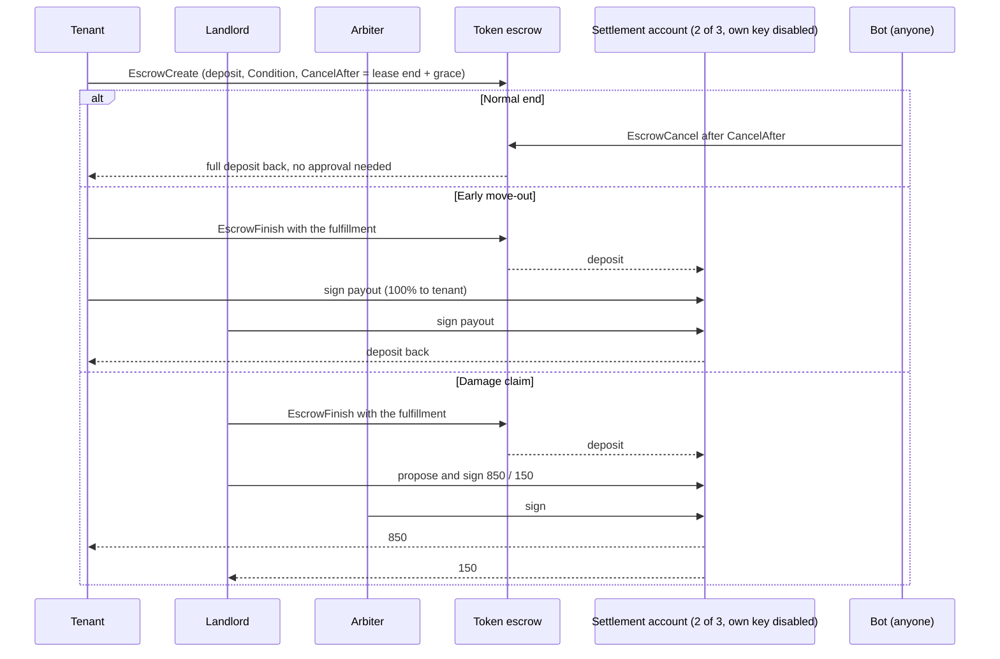

# safeDeposit

**Your deposit, returned by the ledger.** safeDeposit (repo: decelsus) protects rental security deposits with native
XRP Ledger features. The tenant locks the deposit in a token escrow. If the lease ends normally, the ledger hands it
back and nobody has to approve anything. If the tenant moves out early or the landlord claims damage, the deposit moves
to an account that only two of tenant, landlord and an independent, credentialed arbiter can spend from together.
safeDeposit never holds the money and cannot move it. Built in 24 hours for IXH26 (Track 2, XRPL applications);
demo-ready, not production-ready.

## How it works



## XRPL features used

| Feature | Where |
|---|---|
| Token escrow (XLS-85) with an issued token | the deposit itself; `ledger/services.py` `create_escrow`, `finish_escrow`, `cancel_escrow` |
| Crypto-conditions (PREIMAGE-SHA-256) | early release needs a secret; `ledger/conditions.py` |
| Multisig: SignerList (quorum 2 of 3) with the master key disabled | the per-lease settlement account |
| Issued tokens and trust lines, `lsfAllowTrustLineLocking` | test EUR and USD |
| Memos | evidence photos: only the SHA-256 is anchored (`safedeposit/evidence`) |
| Credentials | the arbiter's `VERIFIED_ARBITER` credential, issued by a registry account and accepted by the arbiter |
| Batch | not used: the amendment is not enabled on Testnet (checked 2026-11-20). Payouts are sequential payments. |

## Architecture

Django 5.2 + xrpl-py on the server, server-rendered templates, vanilla JS ES modules + xrpl.js in the browser. No build
step, no frameworks, no CDNs.

```
config/        settings, urls
ledger/        client.py (network allow-list, refuses mainnet), services.py (every ledger operation), conditions.py, errors.py
core/          models.py, lifecycle.py (guarded state machine), api.py (JSON API), views.py (page shells),
               middleware.py (CSP), context.py, management/commands/
templates/     base.html, partials/, escrow/ (home, demo, dashboard, lease_create, lease_detail, arbiter, verify, stage), legal/
static/js/     app.js (global), api.js, ui.js, poll.js, session.js, wallet.js (adapters), ledger.js (browser reads),
               actions.js, parts.js, splitform.js, dec.js, fx.js, sound.js, pages/
static/css/    global.css ("whitepaper" theme)
static/vendor/ xrpl.js 5.3.0 (committed), @gemwallet/api 3.8.0 (fetched by scripts/fetch_vendor.py)
scripts/       setup.py (cross-platform setup), api_walkthrough.py, wallet_walkthrough.py, fetch_vendor.py
```

Pages are shells; each page's module renders from the JSON API. What a persona may do comes only from the API's
`actions` list, and the API enforces the same list.

## Setup

Needs Python 3.11 or newer and git. One script does the setup on Windows 11, macOS and Linux (virtual environment,
packages, `.env` with a fresh secret key, browser libraries, database). It is safe to rerun.

Windows 11 (PowerShell or Command Prompt):

```bash
py scripts\setup.py --demo
```

macOS / Linux:

```bash
python3 scripts/setup.py --demo
```

`--demo` also creates the demo wallets on the XRPL test network and runs the preflight check (about 2 minutes, needs
internet). Then run the app, each command in its own terminal. On Windows the virtual environment's Python is
`.venv\Scripts\python`; on macOS / Linux it is `.venv/bin/python`.

| Step | Windows 11 | macOS / Linux |
|---|---|---|
| Web app, http://127.0.0.1:8000 | `.venv\Scripts\python manage.py runserver` | `.venv/bin/python manage.py runserver` |
| Return bot | `.venv\Scripts\python manage.py run_bot` | `.venv/bin/python manage.py run_bot` |
| Stage leases A, B, C | `.venv\Scripts\python manage.py demo_scenarios` | `.venv/bin/python manage.py demo_scenarios` |

Doing it by hand instead: create a virtual environment, `pip install -r requirements.txt`, copy `.env.example` to
`.env` and set `DJANGO_SECRET_KEY`, then run `scripts/fetch_vendor.py`, `manage.py migrate`, `manage.py bootstrap_demo`
and `manage.py preflight` with the virtual environment's Python.

Keep `DJANGO_DEBUG=1` for local demos (runserver serves the static files). If preflight says token escrow is disabled,
set `XRPL_NETWORK=devnet` and rerun `bootstrap_demo`. Demo keys live in `db.sqlite3` (git-ignored); they are Testnet
keys with no value, and the app refuses to start against mainnet.

Checks (shown for macOS / Linux; on Windows use `.venv\Scripts\python` instead of `.venv/bin/python`):

```bash
.venv/bin/python manage.py test                       # 90 tests, no network
.venv/bin/python manage.py smoke_test --scenario all  # ledger mechanics on Testnet
.venv/bin/python scripts/api_walkthrough.py           # A, B, C through the JSON API (demo mode)
.venv/bin/python scripts/wallet_walkthrough.py        # the browser-wallet paths, with a throw-away wallet
```

## The live demo (under 3 minutes)

1. `demo_scenarios`, then open `/demo/stage/` on the projector. Keep `run_bot` running.
2. **C**: click *Arbiter approves*. 850 / 150 is paid out by two signatures.
3. **B**: click *Tenant moves out*, then *Landlord approves the refund*.
4. **A**: watch the countdown reach zero. About 10 s later the bot returns the deposit. If the bot isn't running, the
   column offers *Run bot now* once 20 s have passed.
5. Open *Public check* on any column: the browser verifies the deposit on the ledger itself.

## Manual test script

With `runserver` and `run_bot` running:

1. `/demo/`: three persona cards with balances and the arbiter's *Verified arbiter* badge. *Act as Giulia*.
2. **A, normal end.** *New deposit*: amount 1000, ends in 2 minutes, grace 1, tick the terms, *Create settlement
   account*. Four checklist steps tick, each with an explorer link. *Sign & lock deposit*. The lease page shows the
   countdown; shortly after it reaches zero a toast says the deposit was returned and the page shows the success state.
3. **B, early move-out.** Create and lock another deposit (ends in 20 minutes). *I'm moving out early*. A proposal of
   100% to the tenant appears with 1 of 2 approvals. Switch to Marco in the demo bar, *Approve this split*. Status:
   Settled, with the payout link.
4. **C, damage dispute.** Create and lock a third deposit. As Giulia, upload a photo under *Evidence*; it appears with
   *Anchored on XRPL*. *Verify* says Match; *Verify an altered copy* says Mismatch. Switch to Marco, *Claim damage*, set
   150 to the landlord, give a reason, submit. Switch to Bari, open *Arbiter*, *Approve this split*. Status: Settled,
   850 / 150.
5. On any lease: *Inspect ledger data* shows the settlement account's raw ledger state; *Share verification link*
   copies `/verify/<id>/`, which works in a private window.
6. Every step is in the *Ledger timeline* with a working explorer link, and the browser console stays clean.

## Browser wallets (GemWallet)

Demo mode (server-held Testnet keys, persona switcher) is the default and always works. A tenant or landlord can also
use GemWallet on Testnet:

- *Connect wallet* proves ownership with one signed challenge (`GET /api/wallet/challenge/`, then
  `POST /api/wallet/link/`). The server checks the signature and that the public key derives the address.
- Lock and release: the server builds the unsigned transaction, the wallet signs and submits it, and the server accepts
  it only after checking the validated transaction on the ledger (right escrow, amount, condition, sender).
- Before locking, the page checks the wallet's trust line and balance and offers a one-click TrustSet and a test top-up.
- **Multisign finding:** `@gemwallet/api` 3.8.0 exposes `signTransaction({transaction})` and `submitTransaction`, with
  no multisign option, so a wallet can't produce a signature for the 2-of-3 payout. Approvals therefore stay on the
  server with demo keys (the button says *Approve (demo key)*). A wallet party can propose a split; the other two
  parties approve it.
- `@gemwallet/api` is fetched by `scripts/fetch_vendor.py`, not committed: its licence allows personal and educational
  use but asks for GemWallet's permission before public or commercial distribution. Ask them before a public launch.

The GemWallet flow was verified against the server with `scripts/wallet_walkthrough.py` (same endpoints, signatures made
by xrpl-py). It has not been clicked through with the real extension yet.

## Security and privacy

- Strict CSP on every page (`default-src 'self'`, no inline scripts or styles, WebSocket only to the configured test
  network). No third-party requests at run time, so no visitor IP reaches a CDN.
- CSRF on every POST; session id rotated on wallet sign-in; one-time, expiring challenges.
- The escrow's release secret leaves the server only in `GET /api/leases/<id>/release-tx/`, for that lease's tenant or
  landlord. Seeds never leave it and are hidden in the admin.
- Evidence photos are served only to the lease's three parties through an access-checked view (`nosniff`, sandboxed).
  File type is checked by signature, size capped at 5 MB, names replaced. Only the SHA-256 goes on the ledger.
- Memos are public and permanent: ids and hashes only, never names.
- Amounts are `Decimal` on the server and BigInt micro-units in the browser. Deadlines use the ledger's close time.
- `templates/legal/` are placeholders and need a lawyer.

## Known limitations

- Demo keys are held on the server (Testnet only). Production would use wallets for every signature.
- A coordinating backend builds transactions and stores the release secret; the ledger still enforces every rule.
- Wallets can't multisign, so payout approvals use demo keys.
- Production would use a regulated euro stablecoin whose issuer enables escrow, and a real arbiter registry.
- Photo EXIF data is not stripped (photos are private to the parties, but should be cleaned before any wider use).
- No rate limiting or user accounts beyond the demo session and wallet sign-in.
- `demo_scenarios` took about 3 min 20 s on a slow connection; on a good one it is well under 3 minutes.

## Branding rules (XRP Brand Toolkit 2026)

- The XRP "X" symbol (`partials/_xrp_symbol.html`) is the official path, unmodified. Black or white only, at least
  20px tall, with clear space of 0.25 x its height. Use it only for "Built on the XRP Ledger" and the verify banner,
  never inside the safeDeposit logo.
- Palette: white / Grey 5 `#F0F3F7` backgrounds, Black `#141414` text, Green `#21E46B` accents (green fills take black
  text; green *text* uses Dark Green `#078139` for contrast).
- The footer states the project isn't affiliated with Ripple or the XRP Ledger Foundation. Keep that line.
- Whitepaper building blocks: `.sec` + `.sec__title`, `.defn` / `.defn--theorem`, `.equation` + `.math`, `.stats`,
  `.titleblock`, `.abstract`. App components (toasts, demo bar, checklist, countdown, split bar, gallery, dialog,
  stage) are section 10 of `global.css`.
